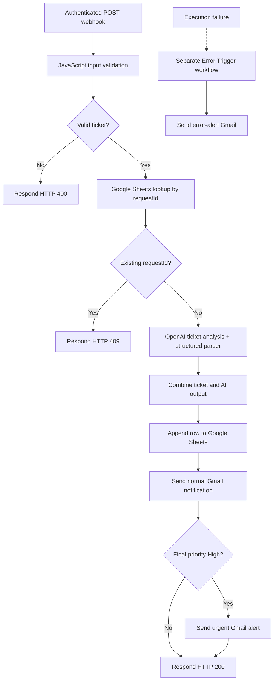
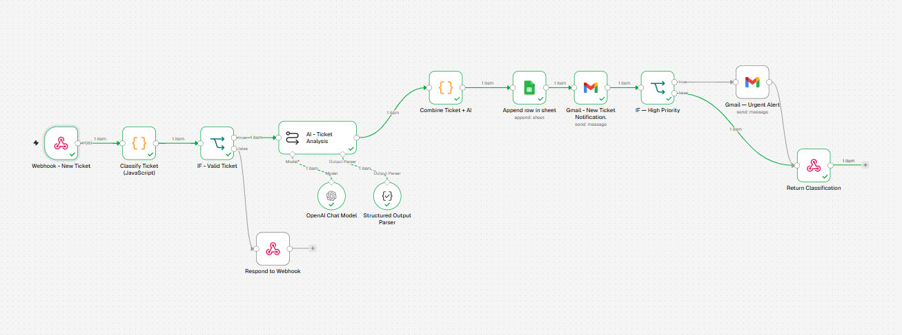
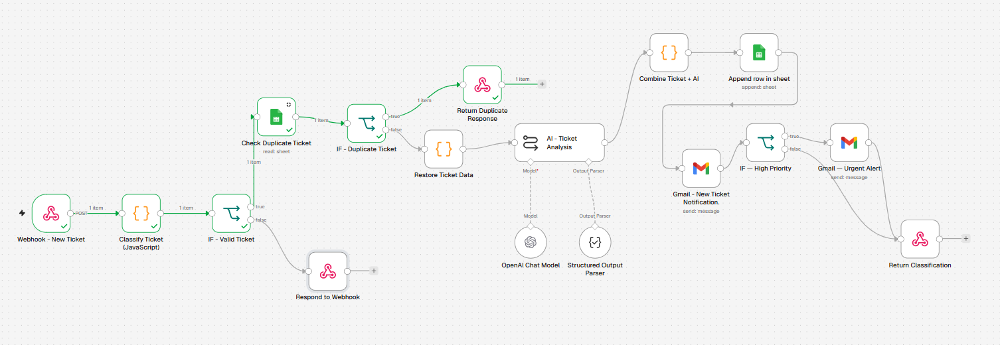
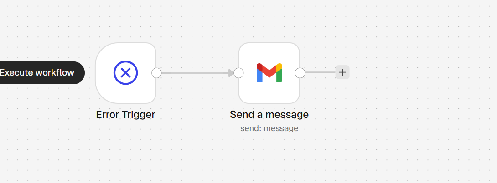

# AI-Powered IT Service Desk — Ticket Triage Automation

**n8n · OpenAI · JavaScript · Google Sheets · Gmail · Webhooks**

A self-hosted automation prototype that receives IT support requests, validates submissions, checks for duplicate ticket IDs, uses an AI model to propose ticket classifications and troubleshooting steps, stores ticket details in Google Sheets, and notifies support staff by email.

> **Status:** Tested portfolio demonstration (not production-ready). All published samples use fictitious data. AI suggestions require human review.

## Problem and goal

IT support teams often receive repetitive requests through different channels. Manual triage can be slow and inconsistent. This project explores how workflow automation and structured AI output can assist with early-stage ticket classification, record keeping, notifications, and basic exception handling.

## Workflow overview



The main workflow combines simple rule-based priority with model-suggested priority without reducing the rule-based priority when the AI suggests a lower level.


## Download and Import the n8n Workflow

The sanitised 17-node n8n workflow is available for educational and portfolio use.

- [Download n8n Workflow JSON](workflows/ai-it-service-desk-sanitized.json)
- [View Import and Setup Guide](workflows/IMPORT_SETUP.md)

The workflow includes webhook authentication, JavaScript validation, duplicate detection, OpenAI classification, Google Sheets integration, Gmail notifications, and HTTP 200/400/409 responses.

**Important:** Credentials, spreadsheet identifiers, email recipients and private configuration have been removed. Reconnect your own services after importing. The separate Error Handler workflow is not included.
  

## Features

- **Header-authenticated webhook:** A private header secret guards the incoming POST endpoint.
- **Input validation:** JavaScript checks the `requestId`, requester email, and nonempty issue summary before calling the model.
- **Sequential duplicate detection:** Google Sheets lookup checks existing `requestId` values and rejects matches.
- **Structured AI triage:** AI returns `aiCategory`, `aiPriority`, `aiCause`, and `aiSuggestedAction`.
- **Ticket storage:** Google Sheets records the submitted ticket, final priority, metadata, and AI suggestions.
- **Notifications:** Gmail sends a normal ticket notification; high-priority tickets additionally trigger an urgent alert.
- **Error monitoring:** A reusable Error Trigger workflow sends Gmail alerts after unexpected execution failures.
- **API outcomes:** `200` for an accepted ticket, `400` for invalid input, and `409` for a sequential duplicate.

## Technology stack

| Layer | Technology | Responsibility |
| --- | --- | --- |
| Automation | n8n (self-hosted) | Routing, integrations, error handling |
| Hosting | DigitalOcean with HTTPS reverse proxy | Runs the n8n service |
| AI | OpenAI Chat Model + Structured Output Parser | Suggested classification and troubleshooting |
| Logic | JavaScript in n8n Code nodes | Input validation and output combination |
| Storage | Google Sheets | Demo ticket register and duplicate lookup |
| Alerts | Gmail | Normal, urgent, and failure notifications |
| Client testing | Windows PowerShell / curl | HTTP request and status verification |

## Screenshots

### Valid ticket execution



### Duplicate request rejected



### Reusable error notification workflow



These screenshots use the workflow editor canvas only. Review screenshots again for sensitive details before uploading publicly.

## Sample request

**Illustrative only:** The public repository does not contain a functioning production URL or a real secret. Configure a private endpoint and credential in your own n8n environment.

```http
POST https://YOUR-N8N-HOST/webhook/YOUR-PRIVATE-PATH
Content-Type: application/json
X-IT-Ticket-Key: <YOUR_SECRET>

{
  "requestId": "DEMO-REQUEST-001",
  "requester": "demo@example.com",
  "summary": "My laptop keyboard is not working"
}
```

One tested response classified the keyboard issue as **Hardware Issue**, suggested **Medium** priority, and returned possible causes and a troubleshooting recommendation. These outputs are suggestions, not definitive diagnoses.

### Sample response — accepted ticket

```json
{
  "requestId": "DEMO-REQUEST-001",
  "ticketId": "DEMO-DEMO-REQUEST-001",
  "requester": "demo@example.com",
  "summary": "My laptop keyboard is not working",
  "priority": "Medium",
  "status": "classified",
  "aiCategory": "Hardware Issue",
  "aiPriority": "Medium",
  "aiCause": "Possible hardware malfunction or connectivity issue",
  "aiSuggestedAction": "Restart the laptop and check keyboard connectivity"
}
```

This is an **illustrative abbreviated response**, not a complete transcript of an execution. Actual returned fields include additional metadata.

## Test evidence

The following results were verified during manual testing of the n8n workflows:

| Scenario | HTTP result | Observed behavior |
| --- | --- | --- |
| Valid ticket before duplicate protection | `200` | AI and ticket pipeline completed |
| Invalid ticket with empty summary | `400` | Validation rejected the request |
| Repeated `requestId` | `409` | Duplicate branch executed; AI, append, and emails skipped |
| New request after adding duplicate protection | `200` | Structured AI classification returned successfully |
| High-priority request | Not separately asserted here | Urgent Gmail branch and alert were observed in earlier tests |
| Intentional execution failure | Production webhook acknowledged the start | Separate error workflow ran and Gmail failure notification was received |

**Note:** With an immediately responding webhook, a `200` response can mean *execution started*, not *execution succeeded*. The intentional failure test was verified through n8n execution results and the Gmail alert.

## How to reproduce (private test environment)

1. Install and secure a self-hosted n8n instance.
2. Set up your own OpenAI, Google Sheets, and Gmail credentials inside n8n; never commit secrets.
3. Create a ticket sheet with these headers:
   `ticketId`, `requester`, `summary`, `priority`, `category`, `receivedAt`, `status`, `note`, `requestId`, `aiCategory`, `aiPriority`, `aiCause`, `aiSuggestedAction`.
4. Import a **sanitized** exported workflow JSON (once added to this repository), or reconstruct the diagram in n8n.
5. Configure the webhook Header Auth credential and select it in the Webhook node.
6. Select the separate published Error Handler in the main workflow's settings.
7. Test from the **main workflow canvas** using the Test URL and one request per listening session.
8. Do not publish a production endpoint until the remaining security and reliability limitations below are addressed.

>  To obtain a real, importable JSON file, download it from the n8n canvas menu, sanitize the JSON, and inspect it before committing. A screenshot is not an importable workflow.

## Security and current limitations

- Auth secret was rotated after being visible in an earlier test log. Do not include it in screenshots, Git commits, exported nodes, or examples.
- Exported n8n workflows may expose **credential names and IDs**, and individual nodes may contain embedded headers or URLs. Review every exported file before sharing.
- Current Google Sheets lookup implements **sequential**, not atomic, deduplication. Simultaneous requests could create duplicate tickets. A database unique constraint or transactional idempotency approach is preferable for production.
- Rate limiting, abuse protections, lifecycle/retention policies, user permissions, data privacy checks, and AI quality evaluation require additional production hardening.
- Ticket descriptions may contain personal information; use fictitious data in demos and set appropriate execution-data retention controls.
- AI suggestions must be reviewed by a human support professional, especially for security incidents.

See [SECURITY_CHECKLIST.md](SECURITY_CHECKLIST.md) for a practical pre-publication review.

## Next improvements

1. Atomic deduplication or idempotency key enforcement outside Google Sheets.
2. Rate limiting and tighter access controls for the external webhook.
3. Automatic notifications or escalations based on an approved priority policy.
4. Operational metrics dashboard (ticket volume, severity, triage time, failures).
5. Defined retention policy, privacy notices, and a human-in-the-loop process for AI suggestions.

## Portfolio value

This project demonstrates integration of **REST-style webhooks, JavaScript validation, AI structured output, branching workflows, OAuth-backed Google services, HTTP response codes, error handling, and functional testing** in a practical IT operations scenario.

*Built as an independent learning and portfolio demonstration in Auckland, New Zealand.*
